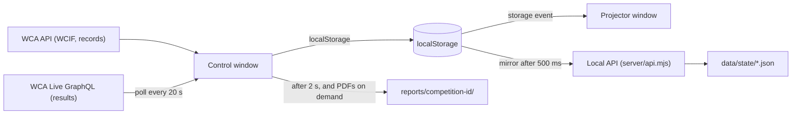

# AGENTS.md

Guide for AI agents working on **WCA Stage**. Read it before you change anything.

## What the app does

WCA Stage runs the schedule of a WCA speedcubing competition from a touch screen and shows it on a projector.

- **Control screen** (`/control/:competitionId`): the stage manager presses "Proceed now" when a group starts. The app tracks delay, shows who competes, judges, scrambles and runs, records incidents, calls staff to the stage and edits projector announcements.
- **Projector** (`/projector/:competitionId`): a second window shows the current and next group, a time bar, records, an advancement estimate, a results carousel, a banner and staff calls. During activities without an event (lunch, breaks, check-in) the results carousel fills the screen and shows every attempt.
- **Festive style**: a projector setting (`festive`, off by default). Off gives the countdown and the finale a plain light look. On adds the dark theme, glows, confetti and fireworks.
- **Countdown**: before the first activity of each day, a "Countdown" slot shows "Starting in HH:MM:SS" on the projector (`src/components/Countdown.tsx`). Its length is a projector setting (`countdownMinutes`, default 15).
- **Finale**: after the last activity, the projector shows a full-screen celebration (`src/components/Finale.tsx`). It appears when the finale slot runs, or after "Stop for today" on the last day.
- **PDF reports**: Options has a button that creates three PDFs: schedule adherence, incident log and records with attempt times (`src/reports/pdfReports.ts`).
- **Portable app**: `npm run portable` builds a folder with Node.js for Windows and Linux. It runs from a USB stick with no install.

The main users are Greek organizers, so Greek (`el`) is a first-class language next to English (`en`).

## Hard rules

1. **Never store, show or log scrambles.** The owner was explicit: no scramble may be visible, "even if you could hack my main pc and find them". `trimWcif` in `src/api/wca.ts` drops scramble sets before anything is saved. Keep it that way. Do not add a WCIF field without checking that it holds no scramble data.
2. **Keep the WCA login token out of the data folder.** `isAppKey` in `src/state/storage.ts` decides which `localStorage` keys go to `data/state/`. The token (`wca-token`) and the live noise status (`noise:*`) must stay out.
3. **Every UI string goes through i18n.** Add each key to both `src/i18n/en.json` and `src/i18n/el.json`. The two files must have exactly the same keys. See "Checks" below.
4. **Only the control window writes polled or automatic data.** The control window polls results and adds template and record announcements. The projector only reads. This prevents duplicates.
5. **Do not edit plan files** in `~/.cursor/plans/` unless the user asks.
6. **No scramble-related features**, even "harmless" ones such as scramble images or scramble counts.

## Code style (from the owner's rules)

- Simple, linear, readable code. No clever one-liners, no premature abstractions.
- Short docstrings that say what the code does. Comments explain "why", never "what".
- Pure logic goes in `src/model/` as plain functions with no React. Components stay thin.
- Constants that tune behavior go in `src/config.ts` or at the top of the module with a one-line comment.
- Chat replies to the owner: direct, active voice, short sentences, no filler. Assume medium knowledge.
- Greek texts: natural Greek, not word-for-word translations. Ask when unsure.

## Tech stack

- React 19, TypeScript 7 (native `tsgo` compiler, run with `npx tsc --noEmit`), Vite 8, react-router-dom 7.
- i18next with react-i18next. `escapeValue: false`, because React escapes already.
- `@cubing/icons` for event icons. Its CSS import is declared in `src/vite-env.d.ts`.
- `pdfmake` 0.3 for the PDF reports. It loads with a dynamic `import()` only when reports are made, because it is large. Its bundled Roboto font covers Greek.
- No UI library and no CSS framework. All styles live in `src/styles.css`.
- Server: plain Node.js (18+) with no dependencies (`server/`).
- Node 20.19+ or 22.12+ is needed to build (Vite 8 requirement). The owner uses Node 24.

## Repository map

```
index.html, vite.config.ts      Vite entry. The dev server also mounts the local API.
src/main.tsx                    Loads saved state from the server, sets language, renders App.
src/App.tsx                     Routes.
src/config.ts                   WCA URLs and tuning constants.
src/api/                        WCA REST (wca.ts), WCA Live GraphQL (results.ts), OAuth (auth.ts).
src/model/                      Pure logic, no React. Most behavior lives here.
src/pages/                      Login, Competitions, OpenPublic, Control, Projector, AuthCallback.
src/components/                 UI pieces used by the pages.
src/hooks/                      useNow, useResultsPoller, useNoiseMonitor, useBrowseNavigation.
src/state/storage.ts            Storage keys, settings types, useSyncedStorage.
src/state/server.ts             Mirrors app keys to the local server (data/state/*.json).
src/incidents/                  Incident editor, @-mentions, Markdown export.
src/reports/                    Schedule log CSV, automatic report saving and the PDF reports.
src/i18n/                       en.json, el.json, i18next setup.
src/format/                     Time, result and download helpers.
src/types/wcif.ts               The WCIF subset the app uses.
server/api.mjs                  Local API: GET/PUT state, PUT reports (.csv, .md, .pdf). Shared by dev and portable.
server/server.mjs               Portable server: serves app/ and the API on 127.0.0.1:5173.
scripts/build-portable.mjs      Builds release/WCA-Stage from dist/, server/ and portable/.
portable/                       start.bat, start.sh and README.txt for the portable folder.
data/, reports/, release/       Generated. Git-ignored. Never commit them.
```

### Key model modules

| Module | Purpose |
| --- | --- |
| `competition.ts` | `buildModel(wcif, countdownMinutes)`: rooms, slots (groups, or activities without groups), rounds and persons. It also adds two kinds of app slots to every room: a countdown before each day's first slot (`COUNTDOWN_CODE`) and a finale 30 min after the last activity (`FINALE_CODE`). Both have negative ids. |
| `finale.ts` | `buildFinale`: podiums of finished finals, records (one per person, event and type), stats, highlights and thanks for the closing screen. |
| `scheduleEngine.ts` | The log of actual starts. `slotTimes` gives actual, projected or planned times. Delay never carries over to the next day, and it is always 0 while the countdown runs. |
| `people.ts` | `peopleForSlot`: competitors, judges, scramblers and runners of a group, from WCIF assignments. |
| `advancement.ts` | Who advanced or just missed, from WCA Live flags or the round rule. Advancing is capped at 75%. |
| `advanceEstimate.ts` | Projector line "Estimated time to advance". Round 1 uses personal bests. Later rounds use the first-round results of the people in the round. Times improve by 2%, and newcomers are spread evenly among them. |
| `resultsSchedule.ts` | Carousel order. New results come first, then today's rounds, with another day's round every 4th pick. |
| `noiseDetector.ts` | Room-relative noise alert with warm-up, hysteresis and cooldown. No React, easy to test. |
| `announcements.ts` | Noise templates and automatic record announcements (WR, continental, NR). They are translated at display time. |
| `attempts.ts` | Attempts per round format, and the number of time-bar segments: attempts + 1. Format `5` (best of 5, 3x3x3 Blindfolded) ranks by single. |
| `pickerGroups.ts` | Groups in the people picker: just missed, fast, everyone else. |
| `records.ts` | World, continental and national records for the projector table. |
| `labels.ts`, `activityCode.ts` | Human labels for activity codes such as `333-r1-g2`. |
| `navigation.ts` | Browsing by group and by event on the control screen. |

## Data flow



- **State** lives in `localStorage`. `useSyncedStorage(key, fallback)` reads and writes it. The browser `storage` event syncs other windows.
- **Persistence**: `writeJson` mirrors app keys to the local API. At startup, `connectToServer` fills missing keys from `data/state/`. It never overwrites a key that already exists in `localStorage`.
- **Offline**: everything works without network once the WCIF is saved. Without the local server (e.g. a static host) the app runs on `localStorage` alone.
- **Disk names**: `:` is invalid in Windows file names, so key `stage:X` becomes `data/state/stage~X.json`.

### Storage keys

| Key | Content | Mirrored to `data/` |
| --- | --- | --- |
| `wcif:<id>` | Trimmed WCIF (no scrambles) | yes |
| `stage:<id>` | Room, start log, "stopped for today" | yes |
| `results:<id>` | Results cache from WCA Live or the WCIF | yes |
| `incidents:<id>` | Incidents | yes |
| `announcements:<id>` | Custom, template and record announcements | yes |
| `projector:<id>` | Projector settings | yes |
| `calls:<id>` | Active staff calls | yes |
| `wca-records` | WR, continental and national records | yes |
| `ui-settings` | Control screen language and options | yes |
| `noise:<id>` | Live noise level from the projector | **no** |
| `wca-token` | OAuth token | **no** |

Settings saved by older versions can miss newer fields. Always merge with defaults: `{ ...DEFAULT_PROJECTOR_SETTINGS, ...saved }`.

## External services

- **WCA REST** (`VITE_WCA_ORIGIN`, default `https://www.worldcubeassociation.org`): `/api/v0/me`, managed competitions, `/competitions/:id/wcif` (login) or `/wcif/public` (no login), and `/api/v0/records`.
- **WCA Live** (`https://live.worldcubeassociation.org/api`, GraphQL, no login). It has its own competition IDs, found by searching the name. Large queries get rejected, so each round is fetched separately. Completed rounds are cached and not fetched again.
- **OAuth**: implicit grant, scopes `public manage_competitions`. The redirect URI is `http://localhost:5173/auth/callback`. That is why port 5173 is fixed (`strictPort`) in dev and in the portable server.

## Checks before you finish

Run these from the project root. All must pass.

```bash
npx tsc --noEmit
node -e "const f=(o,p='')=>Object.entries(o).flatMap(([k,v])=>typeof v==='object'?f(v,p+k+'.'):[p+k]);const r=n=>new Set(f(require('./src/i18n/'+n+'.json')));const en=r('en'),el=r('el');console.log('en',en.size,'el',el.size,'missing in el',[...en].filter(k=>!el.has(k)),'missing in en',[...el].filter(k=>!en.has(k)))"
npm run build
```

Then test in a real browser:

- `npm run dev`, open `http://localhost:5173`, type a WCA competition ID in the public field and open it. This works with no login.
- Check the control screen and the projector in English **and** Greek. Greek strings are longer and overflow first. Test widths of 1280, 1366 and 1920 px.
- For layout or timing work, drive Chrome with `puppeteer-core`. Inside the dev server you can test pure modules directly: `await import('/src/model/noiseDetector.ts')`.
- Fake microphone for the noise meter: `--use-fake-ui-for-media-stream --use-fake-device-for-media-stream --use-file-for-fake-audio-capture=<file.wav>`.
- After UI tests, delete the files your test created in `data/state/` and `reports/`. Keep `wcif~*.json` and `wca-records.json` if the owner had them.
- For portable changes, run `npm run portable` and start `release/WCA-Stage/node/win/node.exe server/server.mjs` (set `PORT` to avoid a clash with the dev server).

There is no automated test suite in the repo yet. The owner's ad-hoc browser scripts sit outside the repo, in `%TEMP%\wca-e2e`, on their machine only.

## Environment gotchas

- **OneDrive folder**: the project used to live in OneDrive on Windows, and copies may still. Edits can leave trailing NUL bytes or, rarely, a cut-off file. After editing, check that changed files end with `}`, `;`, `)` or a newline. Strip trailing NUL bytes if needed:
  ```powershell
  foreach ($f in Get-ChildItem -Recurse -File src) { $b=[IO.File]::ReadAllBytes($f.FullName); $e=$b.Length; while($e -gt 0 -and $b[$e-1] -eq 0){$e--}; if($e -ne $b.Length){[IO.File]::WriteAllBytes($f.FullName,$b[0..($e-1)])} }
  ```
- **Shell**: the owner uses PowerShell on Windows. Use `;` to chain commands, not `&&`, in Windows PowerShell 5.
- **Git**: the repo is on GitHub (`kwpap/wca-competition-dashboard-projector`). Commit only when the owner asks. `.gitignore` patterns for root folders start with `/`: a bare `data` or `reports` would also hide `src/data/` and `src/reports/`.
- **Port 5173** is fixed. If it is busy, the dev server fails on purpose. Another copy is probably running.
- **`.env.local`** holds the OAuth client ID. Never print it or commit it.
- **`vite preview`** does not mount the local API, so state and reports are not saved there. Use `npm run dev` or the portable server.
- **localStorage limit** (about 5 MB): this is why `trimWcif` keeps only the fields the app uses.
- **App slots are not in the WCIF.** The countdown and finale slots have negative ids and no assignments. Code that looks up slots in the WCIF must handle them. Use `isCountdown`, `isFinale` or `isAppSlot` to detect them. Reports skip them.
- **Pass `countdownMinutes` to `buildModel`.** Control and Projector both read it from the projector settings. If one forgets, the two windows disagree on the countdown slot.
- **Vite can miss OneDrive edits.** If the browser runs old code after an edit, restart `npm run dev`. Also restart it after any change to `server/api.mjs`, which Vite loads once at startup.
- **No `prefers-reduced-motion` rule on the finale.** Headless Chrome and many venue PCs report "reduce motion", and that would hide all the confetti. The audience is not the PC operator.

## Known limitations and improvement ideas

- **No unit tests.** The `src/model/` modules are pure and easy to test. Vitest would fit with no other changes. Good first targets: `scheduleEngine`, `advancement`, `advanceEstimate`, `resultsSchedule` and `noiseDetector`.
- **Public mode cannot refresh.** "Refresh from WCA" calls the logged-in WCIF endpoint. A competition opened without login shows "session expired" on refresh. It could fall back to `getPublicWcif`.
- **WCIF fallback has no record tags.** When WCA Live does not list the competition, results come from the WCIF, without WR, NR or PR tags.
- **One control window per competition.** Two control windows would both poll results and write state.
- **Two languages.** Add one by creating `src/i18n/<code>.json` with the same keys and listing it in `src/i18n/index.ts`.
- **Time bar for 333fm and 333mbf** has no attempt segments. Their attempts are not timed like other events.

## When you add a feature

1. Put the logic in `src/model/` as a pure function and keep the UI thin.
2. If it needs saved state, add a key to `storageKeys`. Decide on purpose whether `isAppKey` mirrors it.
3. For a new setting, add it to the settings type and its defaults, and to `OptionsModal`. Merge it with the defaults wherever it is read.
4. Add strings to both language files.
5. Run the checks above, and test both windows in both languages.
6. Rebuild the portable folder if the owner uses it for the next competition.
